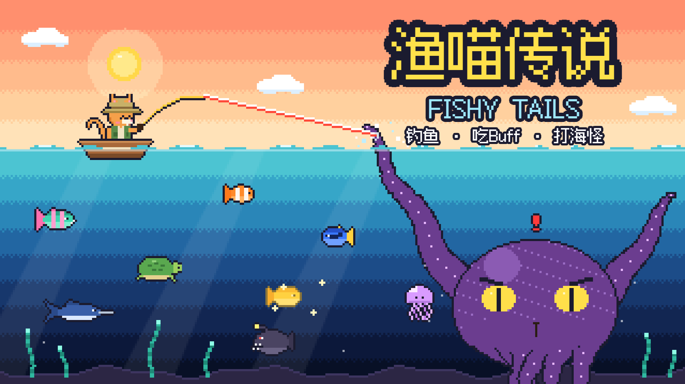

# 渔喵传说 Fishy Tails

竖屏像素风钓鱼小游戏：一只戴渔夫帽的猫，从阳光浅滩一路钓到海底龙宫，最后和海龙王拔河。

**在线试玩：** https://grrreymane.github.io/FishyTails/

**中文 / English**：按浏览器语言自动选择，标题画面左上角可切换。宣传视频：[trailer.mp4](trailer.mp4)（竖屏 21 秒，`tools/trailer.js` 生成）；截图在 [media/shots](media/shots)，英文封面 [media/cover-en.png](media/cover-en.png)（`tools/cover-classic.js`：第一版封面的画面，标题换成游戏里的像素字；穿新装扮的另一版是 `media/cover-outfit.png`，`tools/cover.js` 生成）。上一版封面和视频留在 [media/v1](media/v1)。

## 怎么玩

- **点击**抛竿，鱼咬钩出现 **!** 时**按住**
- **按住收线**，鱼头上出现红色 **!**、鱼线变红时**松手**
- 乱按会拉扯鱼线，断线扣一颗心

## 玩法

- **九片海域**：阳光浅滩 → 彩虹珊瑚礁 → 冰封海湾 → 沉船墓场 → 熔岩热泉 → 无光深渊 → 失落遗迹 → 星光海 → 龙宫
- **一鱼一 Buff**：每种鱼钓上来都会给一个效果（收线更快、断线护盾、放电麻痹……），一局内叠加
- **海怪 Boss**：每片海域钓满 4 条鱼后登场，每只改一条规则：河豚鼓刺、乌贼缠线（连点甩开）、巨蟹数钳子（举几只冲几下）、幽灵鲨隐身、海蛇让鱼线过热（点着拉）、克拉肯吸盘回拉（别松太久）、守护者符文倒数（第三颗再松）、星鲸乘浪（浪来拉、浪退松），海龙王三个阶段把前面学的考一遍
- **闪光鱼**：稀有金色变种，5 倍金币、双倍 Buff
- **特别花色**：普通鱼偶尔带有奶油、薄荷或星点花色，收集后自动在小馆展示；没买鱼缸也有免费的旅行小鱼缸。只改变外观，金币、Buff 和钓鱼操作不变；最多 12 次符合条件的捕获必出一次花色，同种鱼优先发现未收集花色。
- **海边小礼物**：钓鱼偶尔顺带捞到贝壳风铃、漂流瓶等 9 件摆件，自动摆上小馆墙架。随海域进度解锁可发现的物件，优先给未拥有的摆件；首件最多 4 次、之后最多 14 次有可发现摆件的捕获必得，不用兑换或交任务。
- **尺寸冠**：钓到特别大的鱼拿大金冠、银冠，特别小的拿小金冠
- **鱼类图鉴**：记录每种鱼的尺寸范围、捕获次数和冠
- **商店**：金币存进钱包，在标题画面买帽子、鱼竿、船和猫猫花色，每件都有小加成
- **随手逛逛**：钓鱼画面右侧可直接打开商店；右上角小房子菜单里可进入图鉴或「回小馆」，关闭后继续原来的钓鱼进度。
- **渔喵小馆**：从小房子菜单「回小馆」休息，再点「出海」接着钓。鱼获自动做成料理，出海时也继续营业；回馆自动收取营业款，最新料理、海怪招牌、新摆件和新客人会带来不同的欢迎消息。茶点每 5 分钟积累 3 营业款，空店离线 8 小时约 288；离线最多结算 8 小时。普通鱼料理基础售价最低 8，小鱼缸售价 800。默认每 45 秒售出一份鱼料理，座位提高速度，厨具提高售价。魅力吸引串门小动物，不再加快售菜；访客不占座、不消耗食材，也不产生额外收益。
- **两份收入，各有用途**：钓鱼金币买帽子、鱼竿、船和花色，本局钓获金币继续用于分享成绩；小馆营业款与客人小费专门买墙纸、地板、灯具、植物、鱼缸、座位、厨具、地毯、露台和摆件，共 37 件付费装修。装修可以分页浏览、点击名称预览实际摆放效果。旧存档的金币、装修和图鉴都会保留，不需要兑换货币。
- **温馨小馆**：吃过鱼料理的客人冒出爱心，点击聊天并收小费，不点也不影响正常营业；茶点客人不额外产出小费。鱼缸可以挑选已经收集的鱼，闪光鱼和海怪幼崽也能展示；招待客人和放生海龟涨人气，人气升级会迎来企鹅、海獭、海豹、章鱼客人。
- **图鉴奖励**：集齐一片海域的鱼和海怪，小馆展示架上多一件主题摆件（魅力 +3）
- 断光线后可以**从当前海域继续**
- **海况：大风 / 小雨 / 下雪**：第一次打败海龙王后，新一局前可以选海况，逐级叠加，每级一个看得见的新规则，金币 +30% / +60% / +100%。开局弹一张小卡写清这次的规则。
  - 大风：风把浮漂吹沉但不出 !，这时按会把鱼吓跑；海怪规则加强一档。猫穿油布夹克。
  - 小雨：拉鱼太久，鲨鱼鳍会游过来把鱼抢走（不扣心；被抢一次后，接下来两条鱼不会再来）；打败海怪不再回心，护盾最多 2 层；稀有鱼开始出现。猫穿雨披。
  - 下雪：鱼线偶尔结冰，收不动、鱼往回游，连点把冰敲开；开局 2 颗心、上限 4 颗，续关不送护盾、一局最多续关 3 次。猫穿棉服和围巾。
  - 海怪不加新机制，只把自己的规则加强（河豚鼓刺更久、乌贼缠线更勤、巨蟹多举钳、幽灵鲨隐身更久、海蛇更快过热、克拉肯吸得更狠、符文更快、浪更快）。
  - 海况 1 / 2 / 3 通关分别送浪花帽、风暴船、海神冠（不卖，只能挣）。旧存档的 10 级海况按 1–3 → 1、4–6 → 2、7–10 → 3 折算。一场搏斗超过 15 秒鱼会累，不会无限僵持。
- **海怪宝物**：只在海况局里有。每打败一只海怪，从 3 件宝物里挑 1 件，本局有效（下潜后也带着），图标显示在海况标签下面。共 12 件：9 件通用（双钩、回春海草、韧丝、连击扣、雷鳗电池、贪婪钱袋、赌徒骰子、疯狂卷线器、定心锚），3 件只在对应天气出现、把规则变成好处（风铃、驱鲨哨、暖手炉）。
- **无尽深海**：通关海况 3 后开放（弹「恭喜完成全部游戏内容！」「无尽深海模式开放了」）；之后任何海况通关都可以「继续下潜」，回到主页也能接着下潜，直到开新一局。同一局接着钓：第 10 层起按九片海循环，每层鱼和海怪更强、金币更多，预警时间逐渐逼近反应极限。深海里生命最多 4 颗、护盾最多 1 层，放电麻痹减半，削弱鱼的 Buff 有下限。不能续关，心掉光就结束；主页、结算和分享卡记录「最深 第 N 层」。
- **稀有鱼**：每片海各有 1 种稀有鱼（共 9 种），只在海况 2 以上或无尽深海出现，咬钩时冒彩色亮光。每条同时给两个 Buff、金币约为本片海最好鱼的 2.5 倍；小白鲸和麒麟鱼放生加人气，其余 7 种做成小馆新菜。图鉴最后两页是稀有鱼，图鉴总数 54。

## 本地运行

整个游戏是一个 `index.html`，没有构建步骤，直接用浏览器打开即可。图鉴和最高纪录保存在浏览器本地存储里。

字体使用本地 Fusion Pixel 12px 简体中文子集，许可见 `fonts/OFL-fusion-pixel.txt`。更新文字后运行 `python tools/subset_font.py`（依赖上层 Minigame 工作区的字体工具和原字体，不联网）。
